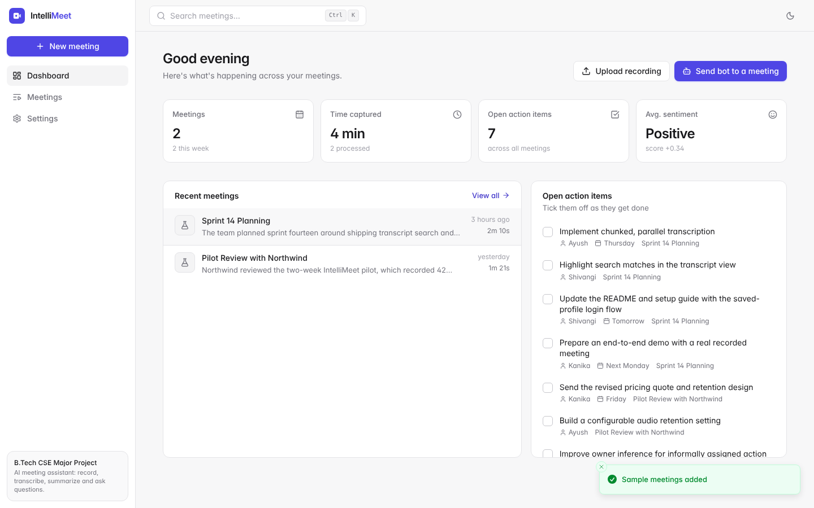

# IntelliMeet

**An AI meeting assistant for Google Meet.** IntelliMeet sends a bot into a Google Meet call, records the audio, transcribes it with Whisper, and turns it into a summary, key points, decisions, action items and a sentiment reading. You can then search every meeting and ask questions about one in a chat.

*B.Tech CSE major project.*



## Features

| Area | What it does |
|---|---|
| **Meeting bot** | Opens Chrome with Selenium, signs in to Google, turns the mic and camera off, asks to join, waits to be admitted, records for a set time, then leaves. You can stop it early from the dashboard. |
| **Upload** | Drag in a recording (MP3/WAV/M4A/MP4/WEBM/OGG/FLAC) or an existing transcript (.txt/.vtt/.srt). |
| **Transcription** | OpenAI Whisper API, or local `faster-whisper` (free, offline). Long files are compressed with ffmpeg before upload. |
| **AI analysis** | GPT or Gemini produce a title, summary, key points, decisions, action items (with owner and due date) and sentiment. A rule-based offline analyzer works with no API key. |
| **Ask AI** | A chat grounded in the meeting's transcript ("who owns what?", "draft a follow-up email"). |
| **Dashboard** | Live progress through each pipeline step, stats, and open action items across all meetings that you can tick off. |
| **Search** | Full-text search over titles, transcripts and summaries, plus a Ctrl/⌘ + K command palette. |
| **Export** | Markdown meeting notes or the raw JSON. |
| **UI** | React + TypeScript + Tailwind, light and dark themes, responsive down to phone width, keyboard accessible. |

## Architecture

```
┌──────────────────────┐    REST/JSON     ┌───────────────────────────────────────────┐
│  React dashboard     │ ───────────────► │  FastAPI server (intellimeet.server)       │
│  Vite · TS · Tailwind│ ◄─────────────── │   ├─ SQLite: meetings, events, chat        │
│  React Query polling │                  │   └─ JobRunner (background threads)        │
└──────────────────────┘                  │        │                                   │
                                          │        ▼  pipeline.py                      │
                                          │   MeetJoiner ─► AudioRecorder ─► Transcriber ─► MeetingAnalyzer
                                          │   (Selenium)    (sounddevice)   (Whisper)      (GPT / Gemini / basic)
                                          └───────────────────────────────────────────┘
```

Meeting states: `queued → joining → recording → transcribing → analyzing → completed` (or `failed` / `cancelled`). Each change is logged as an event and shown in the Activity panel.

```
src/intellimeet/
  config.py          settings from .env
  meet_joiner.py     Google sign-in + Meet join/leave (Selenium)
  recorder.py        audio capture, ffmpeg compression
  transcriber.py     Whisper API / faster-whisper / transcript-file parsing
  analyzer.py        LLM analysis + chat, offline fallback
  pipeline.py        join → record → transcribe → analyse
  cli.py             `intellimeet` command
  server/
    app.py           REST API + serves the built frontend
    db.py            SQLite storage
    worker.py        background job runner
    sample.py        demo meetings
frontend/src/
  pages/             Dashboard, Meetings, NewMeeting, MeetingDetail, Settings
  components/        Layout, CommandPalette, UI kit, meeting widgets
  lib/               API client, formatting, theme
tests/               pytest suite (API + core logic)
```

## Setup

**Requirements:** Python 3.10+, Node 18+, Google Chrome, and ffmpeg (recommended).

```bash
# 1. Backend
python -m venv .venv
source .venv/bin/activate            # Windows: .venv\Scripts\activate
pip install -e ".[dev]"
# optional extras:  pip install -e ".[local]"   (faster-whisper)   pip install -e ".[gemini]"

# 2. Frontend
cd frontend && npm install && npm run build && cd ..

# 3. Configuration
cp .env.example .env                 # then add OPENAI_API_KEY and/or GEMINI_API_KEY

# 4. Run
intellimeet serve                    # open http://127.0.0.1:8000
# then: Settings -> Sign in bot, Test audio, add your AI key
```

With no API keys you can still click **Explore sample meetings**, or upload a `.txt` transcript, to try the full UI.

### Development mode

```bash
intellimeet serve --reload           # API on :8000
cd frontend && npm run dev           # UI on :5173 with hot reload (proxies /api)
python -m pytest                     # tests
```

## Configuration

Everything can be changed in the app under **Settings**. Changes are written to `.env` and take effect immediately, with no restart.

**1. Sign the bot in (Settings → Meeting bot → Sign in bot).** A Chrome window opens on Google's sign-in page. Sign in once, and the bot reuses the session from then on. Use an account that is allowed into your meetings: college/work Google Workspace meetings usually block guests, so use your college account there. A separate account for the bot works best.

**2. Check audio (Settings → Audio capture → Test audio).** The default source is **System audio**. It records what the computer plays, which includes the meeting sound from the bot's Chrome window, and needs no Stereo Mix or virtual cable (Windows and Linux). Play a video, click *Test audio*, and pick the speaker that shows a level. On macOS, install BlackHole and choose it as an *Input device*.

**3. Add an AI key (Settings → AI providers)**, then click *Test AI connection*.

### How the bot joins

1. It opens Meet with the UI forced to English (`?hl=en`).
2. Mic and camera are **blocked at browser level** for meet.google.com, so they can never turn on. The bot still switches the toggles off using their labels, `data-is-muted` and the original project's selectors, with the keyboard shortcuts as a fallback.
3. It types the bot's name (guest mode), clicks **Join now / Ask to join**, and waits in the lobby until someone admits it.
4. It records until the time is up, the call ends, or you press **Stop**.
5. If a join fails, a screenshot and the page HTML are saved in `data/debug/` and the path is shown on the meeting page.

Tips:
- Don't close the bot's Chrome window. Minimising it is fine.
- If you are in the same meeting on this laptop, mute your own Meet tab (right-click the tab → Mute site) so the audio isn't recorded twice.

## CLI

```
intellimeet serve                      web app
intellimeet login                      sign in to Google in the bot's Chrome profile (or use Settings)
intellimeet join --meet-link URL --duration 600 [--no-analysis]
intellimeet process recording.mp3      transcribe and analyse a file
intellimeet devices                    list speakers (system audio) and input devices
```

## API

| Method | Path | Purpose |
|---|---|---|
| GET | `/api/meetings?q=&status=` | List and search meetings |
| POST | `/api/meetings` | Send the bot (`meet_link`, `title`, `duration_minutes`, `analyze`) |
| POST | `/api/meetings/upload` | Upload audio or a transcript (multipart) |
| GET / PATCH / DELETE | `/api/meetings/{id}` | Get details, rename, or delete a meeting |
| POST | `/api/meetings/{id}/stop`, `/retry?mode=rejoin\|reprocess` | Stop early; send the bot again or re-process the recording |
| GET / PUT | `/api/settings` | Read / update settings (persisted to .env) |
| GET / POST | `/api/audio/devices`, `/api/audio/test` | List audio devices; record a 5-second test |
| POST | `/api/bot/login`, `/api/bot/logout` | Sign the bot's Chrome profile in or out |
| PATCH | `/api/meetings/{id}/action-items/{i}` | Mark an action item done or not done |
| GET / POST / DELETE | `/api/meetings/{id}/chat` | Ask AI history, send a question, clear history |
| GET | `/api/meetings/{id}/export?format=md\|json` | Export |
| GET | `/api/stats`, `/api/action-items`, `/api/config` | Dashboard data |

Interactive docs are at `/docs` while the server is running.

## Credits

The bot pipeline (Gmail login → join Meet → record → Whisper → GPT analysis) is modelled on [dhruvldrp9/Google-Meet-Bot](https://github.com/dhruvldrp9/Google-Meet-Bot) (MIT). IntelliMeet reimplements that pipeline from scratch and adds the web app, job queue, storage, uploads, Gemini/local-model support, chat and the offline analyzer.

MIT License.
